# Roadmap do Projeto: Pagina-Login

Este documento serve como mapa visual e guia de evolução técnica para o desenvolvimento da aplicação.

> [!WARNING]
> **Aviso de Estado Atual:** O formulário de **Signup (Cadastro) ainda NÃO está funcional**. A persistência com `localStorage` e a validação do cadastro precisam ser ajustadas antes de serem consideradas ativas.

```mermaid
flowchart TD
    %% Nós de Início / Estado Atual
    subgraph ATUAL ["📍 ONDE VOCÊ ESTÁ AGORA"]
        A1["Estrutura HTML/CSS (Login & Signup)"] --> A2["Eventos de Submit no JS"]
        A2 --> A3["Armazenamento com LocalStorage"]
        A3 --> A4["Console.log (Feedback apenas no F12)"]
    end

    %% Fase 1: Feedback Visual
    subgraph FASE1 ["1️⃣ FEEDBACK VISUAL NA TELA"]
        F1_1["Criar elemento de alerta no HTML"]
        F1_2["Trocar console.log por mensagem colorida na tela"]
        F1_3["Limpar campos após sucesso (form.reset)"]
        A4 -.-> F1_1 --> F1_2 --> F1_3
    end

    %% Fase 2: Alternância de Telas
    subgraph FASE2 ["2️⃣ EXPERIÊNCIA DE USO (UX)"]
        F2_1["Ocultar Signup por padrão"]
        F2_2["Adicionar link 'Criar Conta' no Login"]
        F2_3["Alternar visibilidade (Toggle Login/Signup)"]
        F1_3 -.-> F2_1 --> F2_2 --> F2_3
    end

    %% Fase 3: Validações Reais
    subgraph FASE3 ["3️⃣ REGRAS DE NEGÓCIO"]
        F3_1["Checar campos vazios"]
        F3_2["Impedir e-mail duplicado (usuarios.some)"]
        F3_3["Regra de senha mínima (ex: 6 caracteres)"]
        F2_3 -.-> F3_1 --> F3_2 --> F3_3
    end

    %% Fase 4: Pós-Login
    subgraph FASE4 ["4️⃣ ÁREA LOGADA (DASHBOARD)"]
        F4_1["Salvar 'usuarioLogado' no Session/LocalStorage"]
        F4_2["Redirecionar para dashboard.html"]
        F4_3["Exibir: 'Olá, {nome}'"]
        F4_4["Botão Logout (Limpar sessão e voltar)"]
        F3_3 -.-> F4_1 --> F4_2 --> F4_3 --> F4_4
    end

    %% Estilos dos blocos
    style ATUAL fill:#f1f5f9,stroke:#64748b,stroke-width:2px,color:#0f172a
    style FASE1 fill:#eff6ff,stroke:#2563eb,stroke-width:2px,color:#0f172a
    style FASE2 fill:#f0fdf4,stroke:#16a34a,stroke-width:2px,color:#0f172a
    style FASE3 fill:#fff7ed,stroke:#f97316,stroke-width:2px,color:#0f172a
    style FASE4 fill:#faf5ff,stroke:#9333ea,stroke-width:2px,color:#0f172a
```

---

## Detalhamento das Etapas

### 1️⃣ Feedback Visual na Tela
- [ ] Criar tags `

` nos formulários.
- [ ] Usar variáveis do `variables.css` (`--color-error` e `--color-success`) para estilizar os avisos.
- [ ] Limpar inputs com `form.reset()` após sucesso.

### 2️⃣ Experiência de Uso (UX)
- [ ] Exibir apenas o card de Login por padrão.
- [ ] Link "Não tem uma conta? Cadastre-se" para abrir o card de Cadastro.
- [ ] Link "Já possui conta? Faça login" para voltar ao Login.

### 3️⃣ Regras de Negócio e Validações
- [ ] Impedir envio de campos em branco.
- [ ] Validar e-mails duplicados antes de executar o `push`.
- [ ] Exigir tamanho mínimo de senha (ex: 6 caracteres).

### 4️⃣ Área Logada (Dashboard)
- [ ] Salvar o usuário autenticado na sessão (`localStorage` ou `sessionStorage`).
- [ ] Criar página `dashboard.html`.
- [ ] Redirecionar usuário logado e oferecer opção de Logout.
